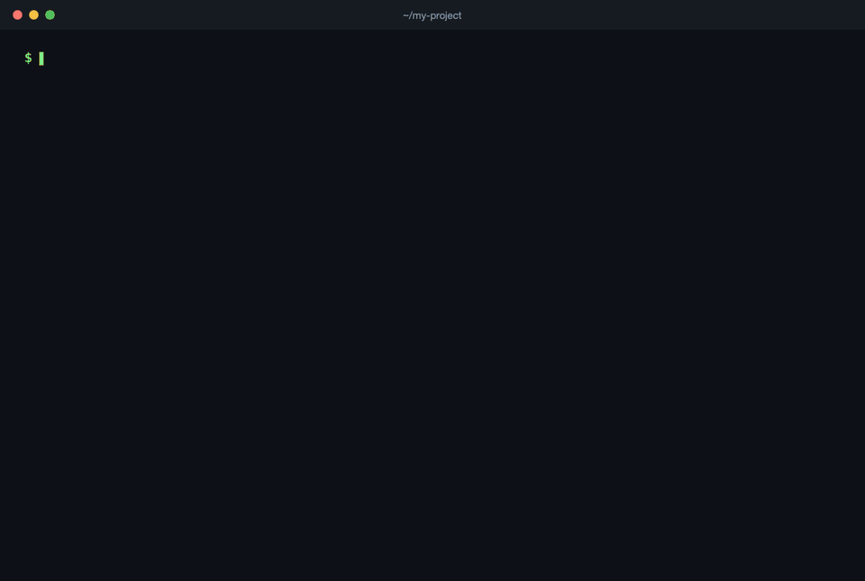

# mcp-leash

Find the dangerous tools in your MCP servers and lock them down in Claude Code — one command.

```sh
npx mcp-leash
```



[](https://github.com/sanjaysubramanian/mcp-leash/actions/workflows/ci.yml)
[](https://www.npmjs.com/package/mcp-leash)
[](LICENSE)

## Why

- Every MCP server you add hands Claude a bag of tools, and some of them delete repos, run shell commands or send messages as you. Most people never read the tool list.
- Claude Code's permission rules can allow, ask or deny a tool, but writing `mcp__server__tool` rules by hand for every server is tedious, so it doesn't happen.
- Permission rules can't look at arguments (Claude Code ignores `mcp__` rules with parentheses). mcp-leash adds a small hook that can, for example "ask before pushing to `main`", and keeps an audit log of every MCP call.

## Quickstart

```sh
npx mcp-leash scan     # see every tool your MCP servers expose, ranked by risk
npx mcp-leash lock     # deny the destructive ones, ask for the ones that change things
npx mcp-leash unlock   # remove exactly what lock added
```

`lock` shows a diff, asks for confirmation, and backs up your settings file first. Restart Claude Code (or reload `/permissions`) afterwards.

## Example output

This is real output from `mcp-leash scan --project test/fixtures/project-basic` in this repo. `fake` is a tiny MCP server used by the tests; `broken` points at a script that doesn't exist, to show that one bad server doesn't stop the scan.

```text
mcp-leash scan  test/fixtures/project-basic

fake (project · stdio · node ../fake-server.mjs)
   CRITICAL delete_thing  destructiveHint:true
   WRITE    send_message  verb "send"
   READ     read_thing    readOnlyHint:true

broken (project · stdio · node ./does-not-exist.js)
  ⚠ could not connect (server exited before answering; check its command and args)

2 servers, 3 tools: 1 critical, 1 write, 1 read

Run: npx mcp-leash lock
```

If your settings already cover a tool, the row ends with `[denied]`, `[ask]` or `[allowed]`.

## How it works

1. **Discover.** Reads your MCP servers from `~/.claude.json` (user scope), `~/.claude.json` under `projects[<path>]` (local scope) and `<project>/.mcp.json` (project scope). When the same name appears twice, local beats project beats user, like Claude Code.
2. **Scan.** Connects to each server with the official MCP SDK (stdio, or streamable HTTP with SSE fallback), calls `tools/list` with a 10 second timeout, then kills what it spawned. Servers that need auth or fail are reported and skipped. `--offline` skips connecting and uses built-in presets only.
3. **Classify.** Each tool becomes `critical` (irreversible or destructive), `write` (changes state or talks to the outside world), `read`, or `unknown`. Order: built-in preset for known servers (GitHub, filesystem, Slack, Postgres, SQLite, Supabase, Stripe, Notion, Linear, Puppeteer, Playwright, Docker, Kubernetes, AWS, shell, Desktop Commander), then MCP annotations (`destructiveHint`, `readOnlyHint`), then verbs in the tool name (`delete`, `create`, `get`, ...). The tool description is only a weak tiebreaker. Every row shows the reason.
4. **Lock.** Writes full tool names such as `mcp__github__merge_pull_request` into `permissions.deny` / `permissions.ask` in `~/.claude/settings.json` (or `--scope project|local`). Levels: `balanced` (default) denies critical and asks for write; `strict` also asks for unknown. Existing rules are never removed or reordered, duplicates are skipped, and a tool that is already denied never gets an `ask`. What was added is recorded in `~/.mcp-leash/state.json`.
5. **Hook.** Unless you pass `--no-hook`, `lock` copies a dependency-free `hook.mjs` to `~/.mcp-leash/hook.mjs` and registers it as a `PreToolUse` hook with matcher `mcp__.*`. It checks `~/.mcp-leash/rules.json`, answers `deny` or `ask` on a match, and appends a redacted line to `~/.mcp-leash/audit.jsonl`.

Other commands: `mcp-leash log [--today] [--server <name>] [--json] [-n 50]` shows the audit trail with calls per server and how many were denied or asked.

## rules.json reference

`~/.mcp-leash/rules.json` (or `$MCP_LEASH_HOME/rules.json`). `lock` creates it with sensible defaults if it doesn't exist and never overwrites it afterwards.

```json
{
  "version": 1,
  "failClosed": false,
  "rules": [
    {
      "tool": "mcp__github__push_files",
      "when": { "branch": "^(main|master)$" },
      "decision": "deny",
      "reason": "No direct pushes to main"
    },
    {
      "tool": "mcp__filesystem__write_file",
      "when": { "path": "!cwd" },
      "decision": "ask",
      "reason": "Write outside project directory"
    }
  ]
}
```

| Field | Meaning |
| --- | --- |
| `tool` | Full tool name. `*` is a wildcard: `mcp__github__*`, `mcp__*__delete_*`. |
| `when` | Optional. Maps a top-level argument name to a regular expression. Every entry must match. Non-string values are JSON-stringified first. A missing argument means no match. The special value `"!cwd"` matches a path argument that resolves outside the session's working directory (relative paths are resolved against it). |
| `decision` | `deny` or `ask`. |
| `reason` | Shown to Claude and you. Optional. |
| `failClosed` | If `true`, an internal hook error denies the call instead of letting it through. Default `false`. |

The first matching rule wins. If nothing matches, the hook prints nothing and Claude Code's normal permission flow applies. Note that a hook `ask` is a prompt, not a block.

`lock` generates the default rules using your actual server names, so a GitHub server you named `gh` gets `mcp__gh__push_files` rules.

## FAQ

**Is the hook fail-open?** Yes. If anything goes wrong inside the hook (bad JSON, unreadable rules, an invalid regex) it writes the error to stderr and exits 0 with no output, so it can never block your work by accident. Set `"failClosed": true` in `rules.json` if you prefer the opposite. It does no network calls and imports no packages, so a call takes about one Node start-up.

**Which clients does it support?** Claude Code only, for now. The permission rules and the hook format are Claude Code's. Scanning works on any `.mcp.json`-shaped config, but nothing is written for other clients.

**Does `scan` run my MCP servers?** Yes, that's how it learns the tool list: it starts each configured server the same way Claude Code would, calls `tools/list`, and stops it. A project `.mcp.json` can contain any command, so don't scan a repo you don't trust. `--offline` never starts anything.

**Does it change tool behaviour or proxy calls?** No. It only edits permission rules and registers a hook.

**What about plugin-provided MCP servers?** Not discovered yet (their tools are named `mcp__plugin_<plugin>_<server>__<tool>`). You can write rules for them in `rules.json` by hand.

**Where is my data?** Everything stays on your machine in `~/.mcp-leash/`. Values under keys matching `token|secret|password|key|auth` are redacted before anything is logged, and known token shapes are masked inside strings.

## Uninstall

```sh
npx mcp-leash unlock                 # removes the rules and hook entry lock added (user scope)
npx mcp-leash unlock --scope project # repeat for each scope you locked
rm -rf ~/.mcp-leash                  # optional: hook copy, rules.json, audit log, state
```

`unlock` only removes entries recorded in `state.json`; rules you added yourself stay. A timestamped backup (`settings.json.mcp-leash.bak-<time>`) is written before every change.

## Development

```sh
npm install
npm run lint && npm test && npm run build
```

Tests never touch your real home directory: they use temp dirs via `HOME` and `MCP_LEASH_HOME`. See [CONTRIBUTING.md](CONTRIBUTING.md).

## License

MIT
